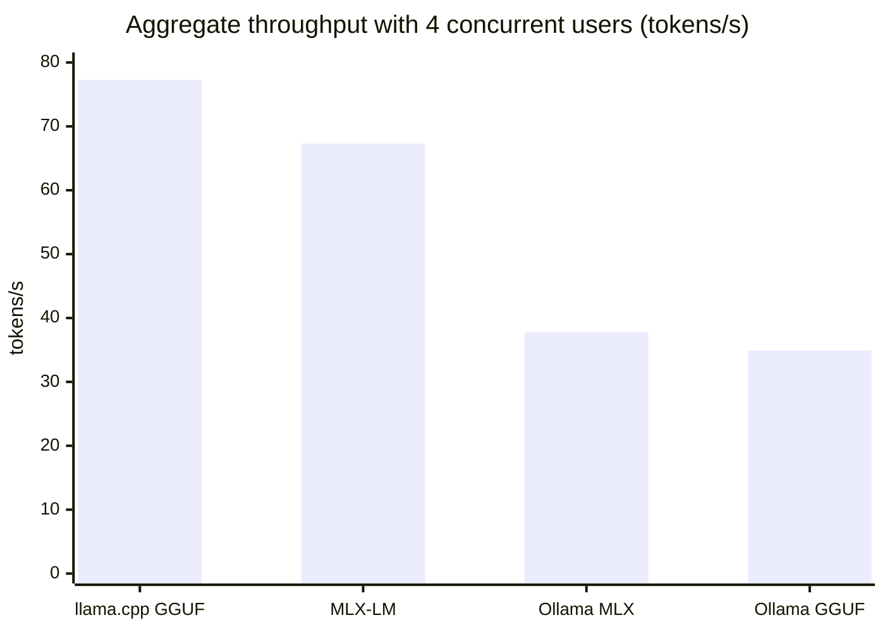

# Local LLM Platform

**Run, serve, benchmark, evaluate and build on open-weight LLMs on your own hardware, with
the engineering standards of a production system.**

[](https://github.com/lionshilov/local-llm-platform/actions/workflows/ci.yml)
[](pyproject.toml)
[](ui)
[](pyproject.toml)
[](https://github.com/astral-sh/ruff)
[](LICENSE)

One model (**Qwen3.5-4B**), two weight formats (**GGUF**, **MLX**), three servers
(**llama.cpp**, **MLX-LM**, **Ollama**) behind one OpenAI-compatible **gateway**, a
ChatGPT-style **chat UI** with live latency metrics, and the measurement tools that show
which setup to use and why.

<!-- SCREENSHOT -->

## Results: one model, four setups, one MacBook

Apple M2 Pro (16 GB) · Qwen3.5-4B at ~4 bits · greedy decoding · thinking off · every setup
benchmarked in isolation with [`llm-bench`](packages/llm-bench).
Raw data: [`benchmarks/results/20261029-191423`](benchmarks/results/20261029-191423/README.md).

| Setup | Decode speed, 1 user | TTFT, 1 user | Throughput, 4 users | TTFT p50, 4 users | Prefill, 3.4k-token prompt |
|---|---:|---:|---:|---:|---:|
| llama.cpp · GGUF Q4_K_M | 39.7 tok/s | **215 ms** | **77.3 tok/s** | **0.77 s** | **444 tok/s** |
| Ollama · GGUF Q4_K_M | 40.1 tok/s | 220 ms | 34.9 tok/s | 22.1 s | 343 tok/s |
| MLX-LM · MLX 4-bit | **50.7 tok/s** | 299 ms | 67.3 tok/s | 0.85 s | 345 tok/s |
| Ollama · MLX NVFP4 | 42.8 tok/s | 255 ms | 37.8 tok/s | 19.9 s | 357 tok/s |



**What the numbers say**

1. **MLX-LM streams fastest to a single user**: 50.7 tok/s, 28% ahead of llama.cpp.
   Decoding is memory-bandwidth-bound; MLX's 4-bit format is smaller (~4.5 vs ~4.9 bits
   per weight) and its Metal kernels are tuned for Apple GPUs.
2. **llama.cpp scales best under load**: throughput doubles from 1 to 4 users (38.6 to
   77.3 tok/s) thanks to continuous batching, and it has the fastest TTFT and prefill.
3. **Ollama serves this model one request at a time.** Its scheduler logs
   `model architecture does not currently support parallel requests` for Qwen3.5's
   hybrid attention/recurrent architecture, even with `OLLAMA_NUM_PARALLEL=4`. Throughput
   stays flat and the fourth user waits **22 s** for a first token. The same GGUF on
   llama.cpp directly: 77 tok/s and 0.8 s.
4. **Ollama's own overhead is negligible.** It runs an embedded `llama-server` for GGUF;
   at one user it matches llama.cpp (40.1 vs 39.7 tok/s, 220 vs 215 ms). The cost is in
   scheduling, not in the token path.
5. **One long prompt stalls everyone else.** With two users sending 3.4k-token prompts,
   in-flight streams freeze while the other prompt is prefilled: ITL p99 of 0.7–4.1 s on
   llama.cpp (two runs) and 4.6 s on MLX-LM. Both prefill in chunks of up to 2048 tokens
   and decode waits for each chunk. This prefill/decode interference is why production
   servers tune chunked prefill and move to disaggregated serving.
6. **Prefill numbers vary between runs** (llama.cpp: 348 vs 444 tok/s across two full
   runs); decode is stable within ~4%. Treat small prefill differences as noise.

**Which setup when**

| Workload | Pick | Why |
|---|---|---|
| One person chatting or coding on a Mac | MLX-LM | Fastest token stream |
| Several users, agents running in parallel, RAG with long prompts | llama.cpp | Batching, best TTFT and prefill, Prometheus metrics |
| Trying models quickly | Ollama | Best model management, but check `ollama show` and whether your architecture supports parallel requests |

More findings, each one a production pitfall with the fix applied here:
[inference/README.md](inference/README.md#things-that-bite-in-production).

## What's inside

| | Module | What it does |
|---|---|---|
| ✅ | [`inference/`](inference) | Serves the same model four ways with matched settings, plus a field guide to the traps found along the way |
| ✅ | [`packages/llm-bench`](packages/llm-bench) | Async load generator for any OpenAI-compatible server: TTFT, TPOT, ITL p99, prefill speed, throughput under concurrency |
| ✅ | [`services/gateway`](services/gateway) | One OpenAI-compatible endpoint for every engine: routing, engine-quirk normalization, streaming with cancellation, Prometheus TTFT/TPOT histograms |
| ✅ | [`ui/`](ui) | ChatGPT-style chat with live per-reply metrics, thinking mode, markdown/code/LaTeX, and an **Arena** that races two engines on the same prompt |
| ✅ | [`benchmarks/`](benchmarks) | Committed, reproducible results with hardware and server-build metadata |
| ✅ | [CI](.github/workflows/ci.yml) | Ruff, strict mypy, unit tests, UI typecheck/tests/build, and an **end-to-end benchmark against a real llama.cpp server** on every push |
| 🔜 | Agent harness | Tool-calling loop from scratch, constrained decoding, sandboxed tools, MCP |
| 🔜 | Eval harness | Task suites, quantization quality vs speed |
| 🔜 | Deploy | Docker Compose with Prometheus, Grafana dashboards and alerts |
| 🔜 | RAG | Local embeddings, vector search, reranking |

Architecture: [docs/architecture.md](docs/architecture.md) · design decisions:
[docs/adr](docs/adr/README.md) · roadmap: [docs/roadmap.md](docs/roadmap.md) ·
learning guide that explains every number from first principles:
[docs/guide.ru.md](docs/guide.ru.md) (in Russian).

## Quickstart

Requirements: an Apple Silicon Mac (llama.cpp and Ollama also run on Linux/CUDA),
[Homebrew](https://brew.sh), [uv](https://docs.astral.sh/uv/) and Node.js 22+.

```bash
git clone https://github.com/lionshilov/local-llm-platform && cd local-llm-platform

brew install llama.cpp ollama
uv tool install mlx-lm && uv tool install huggingface_hub
make install            # Python workspace, UI dependencies, git hooks

make serve-llamacpp     # terminal 1: Qwen3.5-4B on llama.cpp (downloads 2.7 GB once)
make gateway            # terminal 2: API + chat UI on http://127.0.0.1:8000
```

Open http://127.0.0.1:8000 and chat. Start more engines (`make serve-mlx`,
`make serve-ollama`) and they appear in the model picker and the Arena automatically.

Reproduce the benchmark:

```bash
make serve-ollama &     # Ollama must be running to pull its models
make fetch-models       # same model as GGUF, MLX and Ollama builds
make bench              # start each engine, measure it, stop it, merge the report
```

Use the gateway from any OpenAI client:

```python
from openai import OpenAI

client = OpenAI(base_url="http://127.0.0.1:8000/v1", api_key="unused")
reply = client.chat.completions.create(
    model="llamacpp",  # or "mlx", "ollama-gguf", "ollama-mlx"
    messages=[{"role": "user", "content": "Explain KV caching in two sentences."}],
    reasoning_effort="none",
)
print(reply.choices[0].message.content)
```

## How it's measured

- **Real streaming requests**, timestamped per SSE chunk at the socket. No SDK in the way.
- **Closed-loop load** at 1, 2 and 4 concurrent users; each level measured separately.
- **No cache cheating**: every prompt starts with a unique nonce, so prefix caching can't
  skip prefill (verified in the engines' logs: only the 5-token chat-template prefix hits
  the cache).
- **Engines run in isolation**, one at a time, so they never compete for unified memory.
- **Matched settings**: same model, ~4-bit, greedy decoding, thinking off, 4 parallel
  slots, 8k context per request, f16 KV cache.

Details: [llm-bench methodology](packages/llm-bench/README.md#methodology).

## Repository layout

```
├── configs/              # benchmark matrix and gateway backends (YAML)
├── inference/scripts/    # serve-*.sh, fetch-models.sh, bench-all.sh
├── packages/llm-bench/   # benchmark CLI (Python, fully typed, tested)
├── services/gateway/     # OpenAI-compatible gateway (FastAPI)
├── ui/                   # chat UI (React 19, TypeScript, Vite, Tailwind)
├── benchmarks/results/   # committed runs: raw JSON + Markdown tables
├── docs/                 # architecture, roadmap
└── .github/workflows/    # CI incl. end-to-end test on a real server
```

## License

[Apache-2.0](LICENSE)
