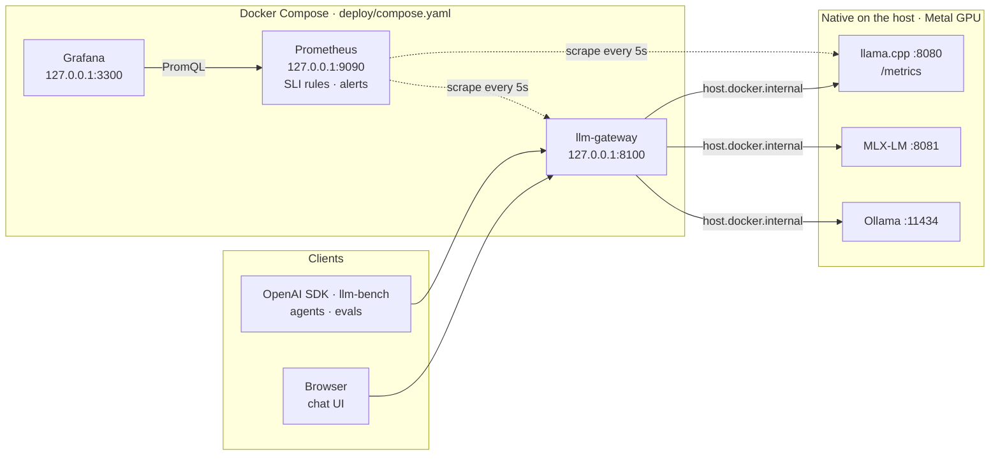

# Deploy and operate

One command starts the gateway, Prometheus and Grafana in Docker. The inference engines
keep running natively on the host. Dashboards, alert rules, alert tests and SLOs are all
code in this directory.



**Why the engines are not in containers.** On macOS, Docker runs containers inside a Linux
VM that has no access to Metal, so inference in a container is CPU-only and several times
slower. The VM also takes a fixed slice of the same unified memory the model needs. So the
model servers run natively, and everything stateless runs in containers and reaches them
through `host.docker.internal` ([pitfall #4](../inference/README.md#things-that-bite-in-production)).
Production uses the same split: model servers run on GPU nodes with their own lifecycle,
and the gateway and observability scale separately.

## Run it

```bash
make serve-llamacpp &                                        # native engine on :8080, --metrics on
docker compose -f deploy/compose.yaml up -d --build --wait   # builds the gateway image, waits for healthchecks
```

| Service | URL | Notes |
|---|---|---|
| Chat UI + OpenAI API | <http://127.0.0.1:8100> | `/v1/chat/completions`, `/v1/models`, `/metrics`, `/healthz` |
| Grafana | <http://127.0.0.1:3300> | Opens on the dashboard; anonymous read-only access. Admin login: `admin` / `$GRAFANA_ADMIN_PASSWORD` (default `admin`, see [`.env.example`](.env.example)) |
| Prometheus | <http://127.0.0.1:9090> | [`/targets`](http://127.0.0.1:9090/targets), [`/alerts`](http://127.0.0.1:9090/alerts) |

The gateway is published on port 8100, so a native `make gateway` can keep port 8000.
Grafana uses 3300 instead of the usual 3000, which dev servers tend to take. All ports bind
to `127.0.0.1`: nothing in this stack has authentication, so none of it is exposed to the LAN.

Send traffic and watch the dashboard react:

```bash
curl -N http://127.0.0.1:8100/v1/chat/completions -H 'content-type: application/json' -d '{
  "model": "llamacpp", "messages": [{"role": "user", "content": "Hello!"}],
  "reasoning_effort": "none", "stream": true, "stream_options": {"include_usage": true}
}'
uv run llm-bench run -c deploy/bench-gateway.yaml --requests 4 --output-dir /tmp/bench
```

To stop: `docker compose -f deploy/compose.yaml down`. This keeps Prometheus and Grafana
data in named volumes; add `-v` to wipe them as well.

| File | Purpose |
|---|---|
| [`compose.yaml`](compose.yaml) | The stack: healthchecks, restart policies, CPU/memory limits, log rotation, named volumes |
| [`gateway.Dockerfile`](gateway.Dockerfile) | Three stages: UI built on the build platform → venv with only the gateway's locked dependencies (`uv sync --frozen --package llm-gateway`) → slim runtime |
| [`gateway.docker.yaml`](gateway.docker.yaml) | Gateway backends, reached via `host.docker.internal` |
| [`prometheus/prometheus.yml`](prometheus/prometheus.yml) | Scrape config: gateway, llama.cpp, Prometheus itself |
| [`prometheus/alerts.yml`](prometheus/alerts.yml) | SLI recording rules and alerts |
| [`prometheus/alerts.test.yml`](prometheus/alerts.test.yml) | `promtool` unit tests: every alert fires when it should, and some cases check that it stays quiet |
| [`grafana/`](grafana) | Provisioned datasource and the [dashboard](grafana/dashboards/llm-gateway.json) |
| [`bench-gateway.yaml`](bench-gateway.yaml) | `llm-bench` config pointed at the containerized gateway |

Container hardening:

- The gateway runs as non-root UID 10001 on a read-only root filesystem, and its code
  belongs to root, so the process cannot modify itself.
- Every service drops all Linux capabilities and runs with `no-new-privileges`.
- Image versions are pinned, and the gateway image has no build tools, `uv` or source code.

## Dashboard tour

**LLM gateway and engines** (`/d/llm-gateway`) is templated by backend and by llama.cpp
instance. Gateway panels use only gateway metrics, so they work the same for any engine.

| Panel | What it tells an operator |
|---|---|
| **Service level** row: Availability · TTFT p95 · TPOT p95 | The three SLIs over the selected time range. A red panel means that SLO was missed in this window. |
| Requests · Output tokens/s · In flight | Current volume. For an LLM, tokens are the unit of work; requests aren't. |
| Queued in engine | Requests waiting for a free llama.cpp slot. If it's above 0, TTFT will rise next. |
| Firing alerts | Count of firing alerts, with a link to Prometheus. Alert periods can also be shown on every graph with the *Firing alerts* toggle. |
| Requests by backend and outcome | Who gets traffic and how each request ended. Red: the server failed. Yellow: the client gave up, often a symptom of slow TTFT. |
| Server-side error ratio | The availability SLI per backend, with lines at 1% (the whole error budget) and 5% (the alert threshold). |
| In-flight requests | Open streams. A flat, non-zero line while nothing completes means a hung stream. |
| Time to first token p50/p95/p99 | Queueing + prefill. If p99 pulls away from p50, requests are queueing; check the slots panel. |
| Time per output token p50/p95 | Decode speed. It rises as more streams share the GPU: you trade per-user speed for throughput. |
| Decode speed per user | The same in tokens/s (1 / TPOT): what one user sees while the answer streams. |
| Output / prompt tokens/s | Load per backend. Prompt tokens drive prefill time, output tokens drive decode time. |
| **Engine** row: up · prefill speed · decode speed · tokens · prefix cache hit ratio · batch size | Health and efficiency of the engine itself. A low cache hit ratio on multi-turn chat means prompts are recomputed. A batch size above 1 means continuous batching is working. |
| Generation throughput | Aggregate tokens/s across all slots vs tokens/s of one sequence. The gap between them is the batching gain. |
| Prompt processing | Prompt tokens/s, prefill speed, and tokens served from the prefix cache. |
| Slots: processing vs queued | Saturation. Processing pinned at `--parallel` with a non-zero deferred count means the engine is at capacity. |
| Tokens generated: engine vs via gateway | A gap means clients that bypass the gateway (benchmarks, agents) are competing for the same slots, outside its limits and metrics. |
| Scrape targets | `up` per target over time, which is what the scrape-down alerts look at. |

When TTFT goes red, check these in order:

1. *Queued in engine* above 0: the engine is out of capacity. Add slots or replicas, or
   shed load.
2. *Prompt tokens/s* rising: prompts got longer.
3. *Prefix cache hit ratio* dropping: prompts are being recomputed.
4. *Engine vs via gateway* gap: someone is bypassing the gateway.

All engine panels are built from llama.cpp's `*_total` counters. Its `*_tokens_seconds`
gauges are reset by every `/metrics` read, so any second scraper (or a `curl`) corrupts
them. `n_busy_slots_per_decode` is only exported as a lifetime average, so the *Batch size*
panel is labelled "lifetime".

## SLOs

| SLO | SLI | Objective | Why this number |
|---|---|---|---|
| **Availability** | Share of chat requests that did not fail on the server side (`outcome` is not `upstream_error`, `upstream_unavailable` or `upstream_5xx`) | 99% over 30 days | A single-node stack with no redundancy. 1% of requests is the error budget. |
| **Time to first token** | p95 of `llm_gateway_time_to_first_token_seconds` for streaming requests, per 5-minute window | ≤ 2.5 s | Chat still feels interactive. |
| **Time per output token** | p95 of `llm_gateway_time_per_output_token_seconds`, per 5-minute window | ≤ 100 ms (≥ 10 tokens/s per user) | Faster than people read. |

Both latency thresholds sit on histogram bucket boundaries, so the SLI is an exact count
of requests under the threshold rather than an interpolated estimate. Client errors (4xx,
such as a prompt longer than the context) and client cancellations do not consume the
error budget. Requests for an unknown model get a 404 from the gateway itself and are not
counted. A backend that is configured but stopped *does* consume the budget, because
clients that pick it get 502s.

## Alerts and runbooks

| Alert | Severity | Fires when | SLO | First steps |
|---|---|---|---|---|
| `LLMGatewayDown` | critical | Gateway scrape fails for 1 min | availability | `docker compose -f deploy/compose.yaml ps` and `logs gateway`. Docker restarts the container if the process exits; if it hangs (`unhealthy`), run `restart gateway`. |
| `LLMEngineScrapeDown` | critical | llama.cpp `/metrics` scrape fails for 1 min | availability | Is the engine running (`make serve-llamacpp`)? Was it started with `--metrics`? On Linux, see troubleshooting. |
| `LLMGatewayHighErrorRatio` | warning | > 5% of requests fail for 5 min | availability | *Requests by outcome*: `upstream_unavailable` = engine down or unreachable, `upstream_5xx` = engine error (check its log), `upstream_error` = streams breaking midway. |
| `LLMGatewayErrorBudgetFastBurn` | critical | Error ratio > 14.4% over both 1 h and 5 min | availability | Same as above. 2% of the monthly budget burns every hour. |
| `LLMGatewayErrorBudgetSlowBurn` | warning | Error ratio > 6% over both 6 h and 30 min | availability | Look for a chronic cause, e.g. clients still using a backend that is down. |
| `LLMGatewayTTFTHigh` | warning | TTFT p95 > 2.5 s for 10 min | latency | Follow the TTFT checks in the dashboard tour above. |
| `LLMGatewayTPOTHigh` | warning | TPOT p95 > 100 ms for 10 min | latency | Too many concurrent streams for the hardware (lower `--parallel`), or something else on the GPU, such as a second engine ([pitfall #5](../inference/README.md#things-that-bite-in-production)). |
| `LlamaCppRequestsQueueing` | warning | Deferred requests seen in every minute for 5 min | latency | At capacity. Raise `--parallel` if memory allows, add a replica, or reject at the gateway (429) instead of queueing. |
| `LLMGatewayRequestsStuck` | warning | In-flight > 0 and nothing completed for 15 min | availability | Check the engine's `/slots`. `docker compose -f deploy/compose.yaml restart gateway` closes the upstream connections. |

There are two kinds of error alerts:

- **The 5% threshold** is simple and resolves soon after errors stop. It works well with
  sparse local traffic.
- **The burn-rate pair** ([SRE Workbook, ch. 5](https://sre.google/workbook/alerting-on-slos/))
  is how this would page in production: a fast burn pages, a slow burn opens a ticket. Each
  also requires a short window, so it resolves soon after the errors stop.

Alerts show up in Prometheus and on the dashboard. The local stack has no Alertmanager; a
real deployment would route on the `severity` label.

Validate and test the rules (CI can run the same commands):

```bash
docker run --rm --entrypoint promtool -v "$PWD/deploy/prometheus:/p:ro" -w /p \
  prom/prometheus:v3.15.1 check config prometheus.yml
docker run --rm --entrypoint promtool -v "$PWD/deploy/prometheus:/p:ro" -w /p \
  prom/prometheus:v3.15.1 test rules alerts.test.yml
```

## Troubleshooting

| Symptom | Cause and fix |
|---|---|
| `/v1/models` shows `available: false`, or the `llamacpp` target is down | The engine isn't running, or it wasn't started with `--metrics`. On **Linux**, `host-gateway` points at the Docker bridge, not loopback: start the engine with `LLAMACPP_HOST=0.0.0.0 make serve-llamacpp` and firewall port 8080. Docker Desktop (macOS, Windows) forwards `host.docker.internal` to the host's loopback, so the default `127.0.0.1` works there. |
| Is it the network or the engine? | `docker compose -f deploy/compose.yaml exec gateway python -c "import urllib.request; print(urllib.request.urlopen('http://host.docker.internal:8080/health').read())"` |
| `port is already allocated` | Something else is using 8100, 9090 or 3300. Change the host side of `ports:` in `compose.yaml`. |
| Token panels are empty for `curl` requests | llama.cpp only sends `usage` in a stream when the client sets `stream_options.include_usage`. The chat UI and llm-bench set it; a plain `curl` doesn't. |
| SLO stats say "no traffic" | They cover the selected time range. Send a few requests or widen the range. |
| Dashboard edits made in the UI don't stick | Provisioned dashboards are read-only by design. Edit the JSON; Grafana reloads it within 30 s. |
| Edited `prometheus.yml` or `alerts.yml` | `curl -X POST http://127.0.0.1:9090/-/reload` |
| 502 with an empty message, slow responses, red bands in *Scrape targets* | The Mac is overloaded and the Docker VM is starved for CPU. Docker Desktop only completes a container's TCP connect after the host side connects, which can exceed the gateway's 5 s connect timeout. Check `uptime` and swap usage. |

## From a laptop to a GPU cluster

The gateway's metrics don't depend on the engine. The SLOs, the alerts and the gateway
half of the dashboard carry over unchanged; only the engine row is specific to llama.cpp.

| Here | Production |
|---|---|
| llama.cpp natively on a Mac (Metal) | vLLM, SGLang or llama.cpp (CUDA) on GPU nodes, one server per GPU or tensor-parallel group |
| `host.docker.internal:8080` | A Kubernetes Service or internal load balancer per model pool |
| One gateway container | A Deployment with ≥ 2 replicas behind an ingress; it's stateless, so autoscale on in-flight requests |
| Two static scrape targets | Prometheus Operator `ServiceMonitor`s, plus NVIDIA DCGM exporter for GPU utilization, memory and temperature |
| `alerts.yml` | The same rules as `PrometheusRule` resources, with Alertmanager routing by `severity` (page vs ticket) |
| llama.cpp engine row | vLLM equivalents: `vllm:num_requests_running` / `vllm:num_requests_waiting` (slots vs queue), `vllm:kv_cache_usage_perc`, `vllm:prompt_tokens_total` / `vllm:generation_tokens_total`, `vllm:prefix_cache_hits` / `vllm:prefix_cache_queries` |
| Anonymous Grafana viewer | SSO, with dashboards provisioned from this repo |

`LLMEngineScrapeDown` already matches `job=~"llamacpp|vllm"`, so adding a vLLM scrape job
is enough for it to be covered.
