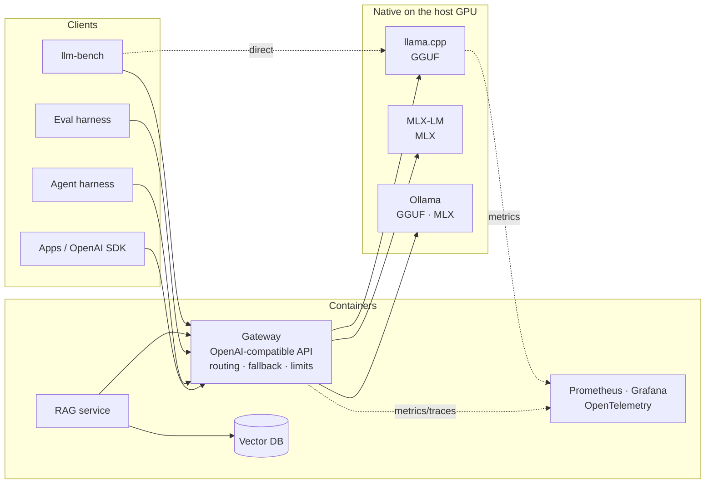

# Architecture

## Target system

## Design principles

**One contract everywhere.** Every component speaks the OpenAI Chat Completions API. An
engine, the gateway, or a hosted provider can replace any other without client changes.
This is also how production stacks avoid lock-in: vLLM, SGLang, TGI, llama.cpp, Ollama and
every major provider expose the same surface.

**Inference native, everything else containerized.** On a Mac only native processes get
Metal. The split also mirrors production, where model servers run on dedicated GPU nodes
with their own lifecycle while stateless services scale independently.

**Measure before claiming.** Performance comes from `llm-bench`; quality comes from the
eval harness. Results are committed with hardware and server-build metadata, so every
number in the docs can be reproduced.

**Config as code.** Engines, scenarios and server flags live in versioned files
(`configs/`, `inference/scripts/`), not in someone's shell history.

Each of these is recorded with its trade-offs in the [architecture decision records](adr/README.md).

## Modules

| Path | Status | Responsibility |
|---|---|---|
| [`inference/`](../inference) | ✅ | Serve one model on llama.cpp, MLX-LM and Ollama with matched settings |
| [`packages/llm-bench`](../packages/llm-bench) | ✅ | Load generator + latency profiler for any OpenAI-compatible server |
| [`services/gateway`](../services/gateway) | ✅ | Routing, engine-quirk normalization, streaming with cancellation, Prometheus metrics, serves the UI |
| [`ui/`](../ui) | ✅ | Chat UI with live metrics, thinking mode and a two-engine Arena |
| `packages/harness` | 🔜 | Tool-calling agent loop from scratch, structured output, sandboxed tools |
| `packages/evals` | 🔜 | Task suites, LLM-as-judge, quantization quality vs speed |
| `services/rag` | 🔜 | Local embeddings, vector search, reranking |
| `deploy/` | 🔜 | Docker Compose stack, dashboards, CI gates |
