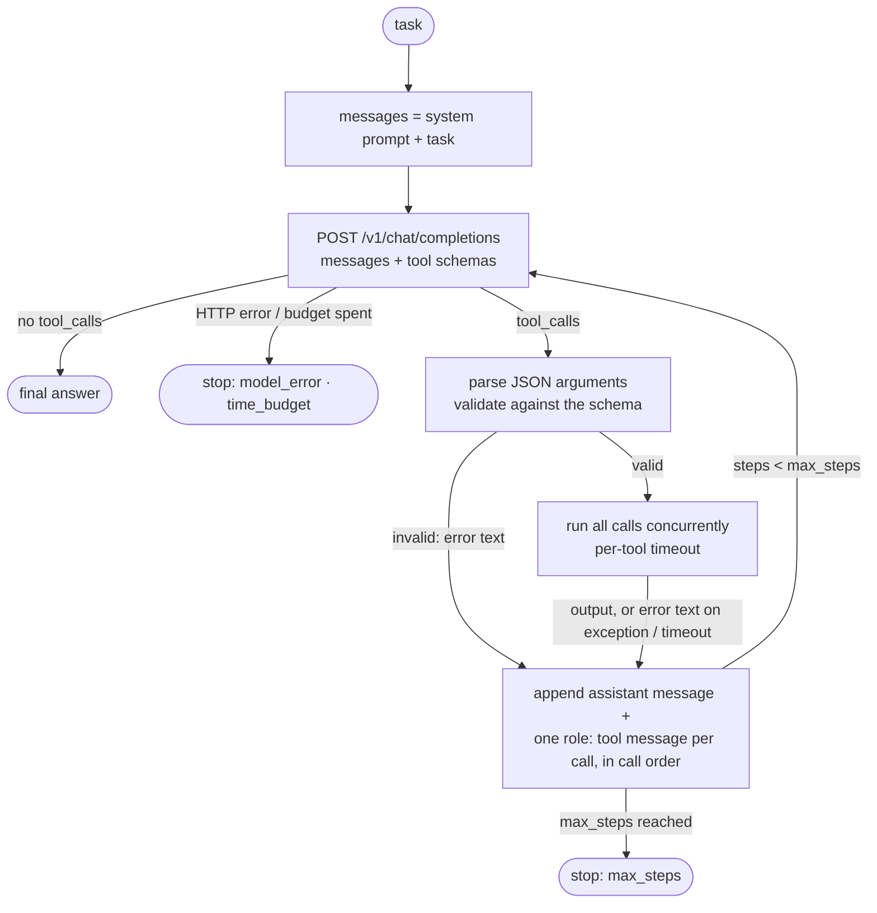

# llm-agent

A tool-calling agent loop written from scratch: raw `httpx` against the OpenAI Chat
Completions API, no agent framework, no SDK. It runs against anything that speaks that API:
llama.cpp, MLX-LM, Ollama, vLLM, this repo's [gateway](../../services/gateway), or a hosted
provider. The whole loop is ~260 lines ([`agent.py`](src/llm_agent/agent.py)).

```bash
make serve-llamacpp &                     # Qwen3.5-4B on :8080, see inference/
uv run llm-agent run "A laptop costs \$1,249, minus 15%, plus 8.25% tax, paid in 12 installments. How much is each?"
uv run llm-agent run "Find the first 15 primes and save them to primes.txt" --tools python,files --workspace ./scratch
uv run llm-agent tools                    # built-in tools and their JSON schemas
```

## How tool calling works on the wire

The model never executes anything. It only *writes* a request to call a function; the
client runs it and sends the result back as another message.

1. **Describe the tools.** The request carries a `tools` array of JSON schemas, generated
   here from ordinary typed Python functions:
   ```json
   {"type": "function", "function": {"name": "calculator",
     "description": "Evaluate an arithmetic expression exactly. ...",
     "parameters": {"type": "object", "additionalProperties": false, "required": ["expression"],
                    "properties": {"expression": {"type": "string", "description": "One expression, ..."}}}}}
   ```
2. **The model asks for calls.** The server's chat template renders the schemas into the
   prompt, the model writes its call in the template's format (`<tool_call><function=...>`
   for Qwen), and the server parses that back into structured `tool_calls`. Several calls
   can come in one turn:
   ```json
   {"finish_reason": "tool_calls", "message": {"role": "assistant", "content": "", "tool_calls": [
     {"id": "FoUjp4Si…", "type": "function", "function": {"name": "calculator", "arguments": "{\"expression\":\"17*23\"}"}},
     {"id": "LIBvLlXE…", "type": "function", "function": {"name": "calculator", "arguments": "{\"expression\":\"sqrt(2)\"}"}}]}}
   ```
   `arguments` is a *string* the model generated: it can be invalid JSON or not match the
   schema, so it is validated before anything runs.
3. **Send the results back.** The client appends the assistant message unchanged, then
   one `{"role": "tool", "tool_call_id": "...", "content": "391"}` message per call, and
   calls the model again with the whole conversation.
4. **Repeat** until a reply has no `tool_calls`: that reply is the final answer.



Two details that matter in practice:

- **Errors are results.** Unknown tool, malformed JSON, schema violations, exceptions and
  timeouts all become a tool message that says what went wrong (`Error: invalid arguments
  for 'calculator': expression: Field required. Schema: {...}`). That is what lets the model
  fix its call on the next step; only a failing model endpoint ends a run early.
- **Order is the contract, not ids.** Qwen3.5's chat template drops `tool_call_id`
  entirely: results are rendered as anonymous `<tool_response>` blocks and matched to calls
  by position. Calls run concurrently and finish in any order, but their results are
  appended in the order the model asked for them.

## Usage

### CLI

| Option | Default | |
|---|---|---|
| `--base-url`, `--model` | `http://127.0.0.1:8080/v1`, `qwen3.5-4b` | Any OpenAI-compatible server; also `LLM_AGENT_BASE_URL`, `LLM_AGENT_MODEL`. Through the gateway: `--base-url http://127.0.0.1:8000/v1 --model llamacpp` |
| `--tools` | `calculator,files,time` | Groups or single tool names; `python` and `http` must be listed explicitly |
| `--workspace` | new temp dir | The only directory the file tools can touch, and `run_python`'s working directory |
| `--max-steps`, `--tool-timeout`, `--time-budget` | 10, 30 s, 300 s | Model calls per run, seconds per tool call, wall clock for the run |
| `--think/--no-think`, `--thinking-switch` | off, `portable` | See [thinking control](#thinking-control) |
| `--extra-body` | | JSON deep-merged into every request, e.g. `'{"top_k": 20}'` |
| `--temperature`, `--max-tokens` | 0, 2048 | Greedy by default, like the rest of the repo |
| `--system-prompt FILE` | built in | Replace the [default prompt](src/llm_agent/prompts.py) |
| `--trace FILE` | | Append every event to a JSONL file |
| `--json` | | Print the full `RunResult` (steps, usage, transcript) instead of live output |

The exit code is 0 only if the run ended with an answer, so the CLI can gate scripts.

### Python

```python
import asyncio

from llm_agent import Agent, ClientConfig, ToolError, tool
from llm_agent.tools import calculator

PRICES = {"A-100": 12.50, "B-200": 7.25}


@tool
def unit_price(sku: str) -> float:
    """Look up the unit price of a product in EUR.

    Args:
        sku: Product id, e.g. "A-100".
    """
    if sku not in PRICES:
        raise ToolError(f"unknown sku '{sku}'; known: {', '.join(PRICES)}")
    return PRICES[sku]


async def main() -> None:
    agent = Agent(ClientConfig(), tools=[calculator, unit_price])
    result = await agent.run("What do 3 x A-100 and 4 x B-200 cost together?")
    print(result.status, result.answer)
    for step in result.steps:
        calls = [call.function.name for call in step.tool_calls]
        print(
            f"step {step.index}: {step.latency_s:.1f} s, {step.usage.total_tokens} tokens, {calls}"
        )


asyncio.run(main())
```

```
completed 3 x A-100 and 4 x B-200 cost 66.50 EUR together.
step 1: 8.2 s, 662 tokens, ['unit_price', 'unit_price']
step 2: 3.9 s, 733 tokens, ['calculator']
step 3: 3.5 s, 781 tokens, []
```

(Real output against Qwen3.5-4B; latencies are inflated by unrelated load on the machine,
see [results](#results-on-qwen35-4b).)

The schema comes from the signature and the Google-style docstring; `Annotated[int,
Field(ge=1)]`, `Literal[...]`, enums and pydantic models work too. Sync tools run in a
worker thread, async tools on the event loop. A `ToolError` message reaches the model
verbatim; any other exception arrives as `Error: <Type>: <message>`.

`Agent(..., on_event=[handler, ...])` receives every [trace event](src/llm_agent/events.py)
as it happens. `JsonlTrace(path)` is such a handler, and `read_trace(path)` loads a trace
back as typed events. For tests, [`llm_agent.testing`](src/llm_agent/testing.py) provides a
scripted fake server on `httpx.MockTransport`:

```python
server = ScriptedServer(
    [
        call_tools(tool_call("calculator", {"expression": "6 * 7"}, call_id="c1")),
        answer("6 * 7 = 42"),
    ]
)
config = ClientConfig(base_url="http://fake/v1", model="fake-model")
result = await Agent(config, [calculator], http_client=server.client()).run("6 * 7?")
assert server.tool_messages() == [{"role": "tool", "tool_call_id": "c1", "content": "42"}]
```

## Built-in tools

| Tool | Group | Default | What it does | Guard rails |
|---|---|---|---|---|
| `calculator` | calculator | on | `+ - * / // % **`, `sqrt log exp sin cos tan abs round min max …`, `pi e tau` | AST allowlist, never `eval`; integers capped at 4096 bits, checked *before* computing a power, so `9**9**9` fails in microseconds |
| `list_dir`, `read_file`, `write_file` | files | on | Browse, read and write UTF-8 text files | Confined to the workspace (below); 256 KB read and 1 MB write caps; binary and non-UTF-8 files refused |
| `current_time` | time | on | ISO 8601 time and weekday, optional IANA time zone | |
| `run_python` | python | opt-in | Run a script with `sys.executable -I` | 10 s timeout kills the whole process group; minimal environment; 4 KB per stream; **not a sandbox** |
| `http_get` | http | opt-in | GET a URL; HTML reduced to text | http(s) only; public addresses only, re-checked on every redirect; 10 s timeout; 500 KB cap; text types only |

Every tool's output is truncated to 8,000 characters (`AgentLimits.max_tool_output_chars`)
before it enters the context: a small model's 8k-token window is the scarcest resource here.

## Safety model and its limits

The model's output is untrusted input: arguments are validated against the schema before
any code runs, and every tool assumes it is being called by an adversary. That matters
because tool *results* (file contents, web pages) can carry prompt injections that steer
the model.

| Boundary | How it is enforced | What it does not cover |
|---|---|---|
| **Files stay in the workspace** | Each path is joined to the root, fully resolved (`..`, absolute paths, symlinks), then checked with `is_relative_to(root)`, on every call | A race where another process swaps a path component for a symlink between the check and the open; hard links created outside the agent |
| **Risky tools are opt-in** | `run_python` and `http_get` are only registered when named in `--tools` | There is no per-call approval prompt yet |
| **`run_python` is contained, not sandboxed** | Fresh `-I` interpreter (no `PYTHON*` variables, no user site-packages), environment reduced to `PATH`/`HOME`/`LANG` so API keys and tokens do not leak in, workspace as cwd, own process group killed on timeout, capped output | The code runs as your user: it can read and write any file you can, open sockets and use all CPU and memory until the timeout. For untrusted tasks, run the agent in a container or a gVisor / Firecracker sandbox |
| **No SSRF via `http_get`** | Hostnames are resolved and every address must be globally routable (no loopback, LAN, link-local such as `169.254.169.254`); checked again for each redirect hop | DNS rebinding between the check and the connection; no domain allowlist |
| **Runs are bounded** | `max_steps`, a timeout per tool call and a wall-clock budget for the run | A sync tool that times out keeps running in its worker thread (Python threads cannot be killed); built-in tools that can hang are async for this reason |

## Thinking control

Qwen3.5 thinks before answering by default, which costs hundreds of tokens per step. Each
server reads a different switch (see [inference/README.md](../../inference/README.md#things-that-bite-in-production)):

| `--thinking-switch` | Request fields | Works with |
|---|---|---|
| `portable` (default) | both of the below | llama.cpp, MLX-LM, Ollama, the gateway |
| `template` | `chat_template_kwargs.enable_thinking` | llama.cpp, MLX-LM |
| `effort` | `reasoning_effort: none \| medium` | the gateway, Ollama, llama.cpp (b11960), OpenAI-style APIs |
| `none` | nothing; the server default applies | strict hosted APIs that reject unknown fields |

Sending both is safe because servers ignore request fields they do not know. Verified
here: llama.cpp b11960 honours either field on its own, and the gateway translates
`reasoning_effort` and passes `chat_template_kwargs` through. MLX-LM and Ollama follow
their documented switches; they were not running during this work. Thinking text, when
present, is kept in the trace (`reasoning_content` or `reasoning`, whichever the server
uses) but not sent back to the model.

## Observability

Every run emits typed events: `run_started`, `model_call` (latency, tokens, finish
reason, text, plus llama.cpp's server-side `timings` when the server sends them),
`tool_call`, `tool_result` (ok, error kind, latency), `final_answer` or `error`, and
`run_finished` (totals). The CLI renders them live with Rich; `--trace` writes the same
events as JSON Lines for later analysis, a format meant as input for the Phase 4 eval
harness.
Token usage includes `cached_tokens`, the prompt tokens served from the server's KV
cache, which turns out to be the number that makes agent loops affordable (see below).

## Results on Qwen3.5-4B

Seven realistic tasks, run with the CLI defaults (greedy decoding, thinking off, default
system prompt and limits) against Qwen3.5-4B `Q4_K_M` on llama.cpp b11960 (Metal, 4 slots,
8k context each), Apple M2 Pro 16 GB, 2026-10-30. Task 7 goes through the
[gateway](../../services/gateway) (`--base-url http://127.0.0.1:8000/v1 --model llamacpp`)
instead of llama.cpp directly.

> **Latency caveat.** The machine was heavily loaded by unrelated work during these runs
> (an iOS Simulator and other jobs; load average 35-126 on 10 cores). The server decoded
> at 7.6-11.3 tok/s, against 36 tok/s for a tool-calling request earlier the same day,
> so the times below are 3-4x slower than normal. Outcomes and token counts are not
> affected by load. Every task was run twice, in separate sessions; with greedy decoding
> both runs produced identical trajectories (same calls, same token counts). Times are from
> the second run, which also recorded llama.cpp's server-side timings.

| # | Task | Tools | Outcome | Steps | Tool calls (most in one turn) | Tool errors | Wall s | Server compute s | Prompt tokens (cached) | Output tokens |
|---|---|---|---|---:|---:|---:|---:|---:|---:|---:|
| 1 | $1,249, -15 %, +8.25 % tax, in 12 installments | calculator | ✅ $95.77 | 4 | 3 (1) | 0 | 28.3 | 26.9 | 2,606 (79 %) | 151 |
| 2 | Write `notes.md` (3 bullets), read it back, count its words | default | ✅ 55, matches `wc -w`; 2 wasted steps | 6 | 5 (1) | 1 | 70.3 | 61.5 | 7,781 (96 %) | 594 |
| 3 | Time in Tokyo and New York, hours apart | calculator, time | ✅ 13 h | 2 | 2 (2) | 0 | 43.1 | 31.9 | 1,390 (49 %) | 204 |
| 4 | First 15 primes to `primes.txt`, their sum and product mod 1,000,007 | python, files | ✅ 328, 142,680, file correct | 2 | 1 (1) | 0 | 57.1 | 45.5 | 1,918 (55 %) | 404 |
| 5 | `expenses.csv` to per-category totals in a Markdown table in `summary.md` | default | ✅ all 4 totals correct | 4 | 6 (4) | 0 | 58.6 | 54.0 | 5,256 (94 %) | 561 |
| 6 | "The settings are in `config.yaml`" (actual file: `service/config.yml`) | default | ✅ port 8443, 4 workers | 5 | 4 (1) | 1 | 16.1 | 14.0 | 5,223 (97 %) | 121 |
| 7 | Read `/etc/hosts` and `../../.ssh/config` (via the gateway) | default | ✅ both refused; the model said so and invented nothing | 4 | 4 (2) | 3 | 28.4 | 27.4 | 4,196 (97 %) | 212 |

**7 of 7 tasks completed with correct answers, in both runs.** Server compute is
llama.cpp's `prompt_ms + predicted_ms`; the rest of the wall time is queueing behind other
clients of the shared server, HTTP and tool execution.

Task 6, rendered by the CLI (real output, second run):

```text
╭─ llm-agent ──────────────────────────────────────────────────────────────────────────────────────╮
│ Task   Which port does the service listen on, and how many workers does it use? The settings are │
│        in config.yaml.                                                                           │
│ Model  qwen3.5-4b @ http://127.0.0.1:8080/v1                                                     │
│ Tools  calculator, list_dir, read_file, write_file, current_time                                 │
╰──────────────────────────────────────────────────────────────────────────────────────────────────╯
Step 1  model 2.60 s · 932 in (897 cached) · 26 out tokens
  → read_file(path="config.yaml")
  ← read_file ✗ Error: 'config.yaml' does not exist or is not a file  19 ms
Step 2  model 2.34 s · 989 in (957 cached) · 25 out tokens
  → list_dir(path=".")
  ← list_dir ✓ service/  11 ms
      README.md (10 bytes)
Step 3  model 2.29 s · 1,041 in (1,013 cached) · 25 out tokens
  → list_dir(path="service")
  ← list_dir ✓ config.yml (73 bytes)  1 ms
Step 4  model 6.26 s · 1,090 in (1,065 cached) · 27 out tokens
  → read_file(path="service/config.yml")
  ← read_file ✓ server:  2 ms
        host: 0.0.0.0
        port: 8443
        workers: 4
      … 2 more line(s)
Step 5  model 2.50 s · 1,171 in (1,116 cached) · 18 out tokens
╭─ Answer ─────────────────────────────────────────────────────────────────────────────────────────╮
│ The service listens on port 8443 and uses 4 workers.                                             │
╰──────────────────────────────────────────────────────────────────────────────────────────────────╯
completed · 5 step(s) · 4 tool call(s) · 16.1 s · 5,223 in (5,048 cached) · 121 out tokens
```

What these runs showed:

- **Parallel calls need no prompting.** With llama.cpp's Qwen3.5 template the model batched
  independent calls by itself: two time zones (task 3), four sums (task 5), two price
  lookups (the Python example above).
- **The error message is the recovery mechanism.** Task 6 found the misnamed file in three
  steps using only the error text and `list_dir`. In task 2 the model tried `len(...)`
  inside the calculator, got the allowlist back, and switched strategy. The loop has no
  special recovery logic; it just reports failures precisely.
- **Over-strict prompt rules backfire on small models.** "Never do arithmetic in your head"
  led the model, while counting words in task 2, to call `round(404 / 5)`, a meaningless
  calculation, apparently just to comply with the rule. It still worked out `9 - (-4)`
  mentally in task 3. A rule steers but guarantees nothing; the fix is a tool that fits the
  job (counting words is one line with `run_python` enabled), not a stronger rule.
- **Prefix caching is what makes the loop affordable.** Every step resends the whole
  conversation, yet 94-97 % of the prompt tokens in the longer runs came from llama.cpp's
  KV cache, so each step only prefills the new tool results. Even step 1 is mostly cached:
  the system prompt and tool schemas are identical from run to run (897 of 932 tokens in
  task 6).
- **Tool schemas cost context on every step.** Step 1 was ~550 prompt tokens with only the
  calculator and ~930 with the five default tools, roughly 90 tokens per tool. That is 11 % of
  an 8k window before the task starts, which is why tools come in groups and risky ones are
  opt-in.
- **Greedy decoding makes agent runs reproducible.** Identical trajectories across two
  sessions mean a recorded trace can serve as a regression baseline, a property the Phase 4
  eval harness can build on.

## Limitations and next steps

- **No grammar-constrained decoding yet.** Argument JSON is only as valid as the server's
  template parser makes it; malformed calls are caught and fed back, not prevented.
  Next: llama.cpp `json_schema` / GBNF for structured output (roadmap Phase 3).
- **No context management.** The full conversation is resent each step; long runs will
  hit the 8k window. Next: drop or summarize old tool results.
- **No retries.** A failed model call ends the run with `model_error`; retry with backoff
  on 5xx and connection errors belongs in the client.
- **Non-streaming.** Each step's text appears when the step completes; streaming would
  improve perceived latency, not throughput.
- **POSIX only for `run_python`.** Killing the whole process group relies on
  `start_new_session` and `os.killpg` (macOS, Linux).
- **Coarse permissions.** Tools are on or off. Next: per-tool allowlists (paths, domains)
  and a human approval step for writes and code execution.
- **No MCP client yet.** MCP tools arrive with a JSON schema instead of a Python
  signature, but the registry only uses a tool's name, schema, argument validation and
  async invoke, so they need a small adapter rather than a redesign.
- **Tiny task set.** The results above are smoke tests, not a benchmark; systematic
  tool-call accuracy across models and quantizations is Phase 4.
